# Desktop app

A Tauri + Vue desktop shell over the same engine the CLI uses. Nothing
in the app calls Rimmerge's own logic differently than the CLI does; it
gives that logic a UI.

## Setup

The first thing you see if no path is pinned yet
(`config.json` is empty or missing; see [install.md](install.md)).
Lets you point the app at your RimWorld install, workshop folder, and
`ModsConfig.xml` directly, or confirm what auto-detection found. When no
install is found, the page lists every location it checked; enter or
browse to your game folder (for Steam, `steamapps\common\RimWorld` in the
library that holds the game) and the remaining fields fill in from it:
the workshop folder, and the profile folder alongside `ModsConfig.xml`. A
field you changed yourself is never overwritten. A folder that is not a
RimWorld install is flagged but does not block Load; choose **Save as
defaults** to keep your choice.

## Dashboard

The landing page once a profile is open: a getting-started strip, then a
summary of the current report (active mod count, open findings by kind)
and quick links into the pages below.

The strip has four steps: get the recommended rules, use the suggested
order, Apply, confirm. Each step's state is read from what the app
already knows (which order is selected, whether your active order is
already the suggested order, whether the active-mod set has changes no
rescan has picked up, and what the recommended-rules step below reports),
so nothing about your progress is stored, with one exception: Skip on step
one. It does not claim you reviewed the
suggestion; it links to the Load order page and leaves that to you.
"Done" means your active order (what RimWorld will load) matches the
suggested order as of the last scan or apply, and no activation change is waiting for a rescan. While the
working set is stale, step two offers Rescan instead of Apply, even if the
file matched at the last scan. The number of findings that still need input appears as
a quiet line with a link to the Inbox; it never blocks Apply.
Once every step is done the strip ends with a **Launch RimWorld** button, the
same one the sidebar shows under Apply (see
[Launching RimWorld](#launching-rimworld)).

**Step one, Get the recommended rules,** downloads the two importable
rule databases (the community load-order rules and the Steam Workshop
database) and imports them into this profile, so the suggested order you
review next already uses them. It never runs on its own: nothing happens
until you click, and the step lists, before you do, what the click will do
for each source (turn it on and download it, download it, or import the
copy already downloaded). The button names the size, about 49 MB, only
when the Steam Workshop database has to be downloaded; it reads **Try
again** when a download failed last time, and **Import** when only an
import is left. The click downloads only the sources that are switched off or not downloaded yet, never imports a
source this profile already imported, and never touches your own RimSort
`userRules.json`. A progress line names the source being downloaded, with
a note that the Steam Workshop database can take a few minutes on a slow
connection, and a message afterwards says what happened: everything
imported, some downloads failed (what did download was imported), nothing
could be downloaded, there was nothing to do (an already-finished step
clicked again), the import failed (one sentence says whether the downloaded
file could not be read or the rules could not be saved, with the technical
details underneath), the import record could not be saved (click again),
or another profile was opened meanwhile.

The step is one of five states. **Offered** holds the strip on step one
until you act (importing changes the suggested order, so even a matching
`ModsConfig.xml` does not read as finished while the step is offered).
**Not available** appears when something has to be downloaded but
internet access is off (with a link to Settings) or the first-run notice
on the Dashboard is not answered yet; it never holds the strip, which
moves on to step two. A step that only needs an import ignores both
gates, since importing contacts nothing. **Skipped** is what **Skip**
leaves: remembered for this profile, the strip moves on, and a **Get them
now** button stays. The skipped row lists what the click would do for each
source, exactly as the offered row does, and the button names the size
(about 49 MB) when the Steam Workshop database would be turned on and
downloaded, so nothing is switched on or downloaded without being said
beforehand. While internet access is off or the first-run notice is
unanswered, a click that needs a download is refused with a message
saying which. **Done** means every importable source has been
imported into this profile at least once; newer downloaded content is the
job of the "New rule content to import" notice, not of this step. While a
click is running the step shows its progress, in every window, and a
second click is refused. The Rules page's Databases card remains the
other way to download, then import.

A project opens on the **suggested** order, the one Apply writes by
default. The Current/Suggested switch in the app shell changes which
order the pages show and which one Apply writes; the choice is not
saved, so the next load opens on Suggested again. A rescan keeps the
order you had selected. Apply writes the order named in the dialog's
"Order" row, which is sent with the request.

**Mods that move** (on the Dashboard, in the strip and in the Apply dialog)
is how many mods the suggested order places differently from the current
one. It is measured against the orders as they are now, not against the
moment the sorter last ran, so it falls to 0 as soon as an Apply makes the
current order the suggested one, and it follows any later change to either
order without a rescan.

The app can also list the **hard problems** in the order Apply would
write: a required mod that is not active, two active mods declared
incompatible, a mod in `ModsConfig.xml` that is not on disk, a violated
hard load requirement, or an unmet load-time any-of (see [the ledger
page](concepts/ledger.md#hard-problems-at-apply)). Each carries whether
you already decided its finding in the Inbox.

In the Apply dialog, a "N problems to confirm" row lists them. Clicking
Apply while any is still undecided replaces the buttons with an "Apply
anyway?" panel: the undecided problems, the ones already decided in the
Inbox (listed apart), a link to the Inbox, and **Go back** (focused) and
**Apply anyway**. If every problem was already decided, nothing is asked.
Pressing Apply also reads `ModsConfig.xml` again, right then (not the
5-second check described under the Mods page); what it finds is then what the
Mods page marks, the note on other pages and the Launch button follow too, even
if you go back. If the list was changed
outside Rimmerge since it last read or wrote it, and the order you are
applying would overwrite that change, the same panel names it first: how
many mods were added and removed, or that the order was changed. The
outside change and any undecided problems share one panel, so **Go back**
stays the focused button. Nothing is asked when the file already holds the
order you are applying. **Apply anyway** still saves a timestamped backup of
the changed file before writing, and the success message names it. If the
file changes again after that check, while you are deciding, the backup still
keeps whatever it held when Apply wrote.
With "Write your active mod list" unchecked, `ModsConfig.xml` is not written, so it skips the question.
If RimWorld looks like it is running, a separate "Write anyway" prompt
comes after this one; the two are never one button.

## Launching RimWorld

The **Launch RimWorld** button sits in the sidebar under Apply, and again at
the end of the Dashboard strip once its steps are done. It starts the game;
Rimmerge stays open.

**How the game is started.** A Steam copy is started through Steam
(`steam://run/294100`), so Steam's own launch settings apply. Any other copy
(GOG, a standalone folder) starts `RimWorldWin64.exe` directly from the
install folder, with no arguments. A copy counts as a Steam copy only when
Steam's own record names that folder: the folder sits in a library's
`steamapps/common`, the library's `appmanifest_294100.acf` names it, and the
library is listed in a Steam folder's `libraryfolders.vdf` (the Steam
folders are the ones Steam records in the registry, then the Program Files
defaults). A folder
copied out of Steam, or a backed-up library, is not mistaken for the real one
(Steam would start a different folder). A Steam copy whose Steam folder neither the
registry nor the Program Files defaults name is started directly through
`RimWorldWin64.exe`, since its library cannot be found.

**What the button says.** It reads from the **selected** order and the last
scan or apply, the same caveat as the strip: an edit made to `ModsConfig.xml`
by another tool since then is not seen until a rescan. The status refreshes
every five seconds while the window is visible, and when you come back to it.

- **Launch RimWorld** (enabled): a click starts the game, then the button
  reads **Starting RimWorld…** until the game shows up in the process list
  (or 30 seconds pass). The sidebar and strip buttons share that state, so
  a click on one disables the other and a second click cannot start the game
  twice.
- **Apply first?** When `ModsConfig.xml` does not hold the order you are
  looking at (or activation changes are waiting for a rescan), a click asks
  first, with **Cancel** (focused), **Launch anyway** and **Apply first**.
  Apply first opens the ordinary Apply dialog with all its usual
  confirmations and, once it has written `ModsConfig.xml`, launches. If you
  uncheck "Write your active mod list" there, or close the dialog, nothing
  is launched.
- **RimWorld is running** (disabled): the game is already up.
- **Disabled with a note**: the install has no `RimWorldWin64.exe`, or the
  status check failed (a short line says so). Until the first answer arrives
  the button is disabled with no note. After that it shows the last answer,
  and a click first waits for a fresh one, which can wait behind a long
  command such as Verify; the button stays disabled meanwhile rather than
  guessing.

Launching writes nothing: no file, no setting. The only write on this path is
the Apply you may choose in the prompt. If Steam's links are not set up on the
machine, Windows may show its own prompt instead of Rimmerge reporting an
error. Rimmerge opens no connection to start the game (see
[privacy and network](privacy-and-network.md)).

## Inbox

The ledger, one row per finding. See
[concepts/ledger.md](concepts/ledger.md) for the model behind it.
Every row here is a `Finding`, carries a suggested `Action` and a
confidence score, and can be filtered/searched. Deciding a finding here
is what a later sort/apply will honor.

## Order (`/order`, `/order/:modId`)

The suggested load order, with a why-panel: click any mod (or open
`/order/:modId` directly) to see the edges that placed it where it is:
which mod it must follow, why, and how strong that requirement is. See
[concepts/sorting.md](concepts/sorting.md).

### Sharing a load order

The page header has two menus. **Export** writes the order that is in
`ModsConfig.xml` now, which is what RimWorld loads, and not the order the
page is showing (the app opens on Suggested, which you may never have run).
*Save as RimWorld mod list (.rml)…* opens the save dialog in RimWorld's own
`ModLists` folder when it exists, so the game's "Load list" finds the
file; only a `.rml` name is accepted. *Copy as text* puts a numbered list
on the clipboard for a chat message. A mod Rimmerge cannot list is left out
and the toast says how many.

**Import** takes a `.rml`, a `ModsConfig.xml`-shaped file, a RimWorld save
(`.rws`; only the mod list in its header is read) or a text list, from a file
or a paste, and always
shows a preview first. *Import from a save…* opens a list of the saves in
RimWorld's `Saves` folder (the one beside the `Config` folder that holds
`ModsConfig.xml`), newest first, with the save's name and the date it was last
saved, at most 200 of them (it says how many older ones are not shown; the
screenshot below shows the list). *Preview*
on a save opens the same preview as any other import; *Browse…* opens the file
dialog in that folder for a save kept elsewhere. When the `Saves` folder is not
found next to your `ModsConfig.xml`, or cannot be listed, the dialog says so and
Browse still works. The list itself reads only file names and dates; no save is
opened until you press *Preview* or pick one. *Open a mod list file…* accepts a
save too. The preview says which RimWorld version the list was
made with ("From a save made with RimWorld ..." for a save), adds a note when
this install is a different release, and says when the names or the Workshop ids
had a different length from the ids and were left out. It names
what will be activated and deactivated, measured against the active list you have
in Rimmerge now (the Mods page's Active list, pending changes included; the list is
the whole active set; Core is never deactivated), the mods that aren't installed (with an *Open on
Steam Workshop* button where the list knows the item; Rimmerge never
downloads anything, and *Copy the missing list* gives you the text to ask a
friend), mods listed twice, mods matched to another copy of themselves, and
lines that were not understood. A file that can't be read as a list shows its
reason and offers no import. *Use this order* is enabled only when the
backend says the order can be imported; when it is disabled the preview
says why (Core isn't installed, none of the listed mods is installed, the
order would be too long, or it names a mod that isn't installed or names
one twice). A list that leaves Core out is not refused: Core is kept first. If your installed mods change between the preview and the
click, the import is refused, the preview closes and a notice asks you to
preview the list again.

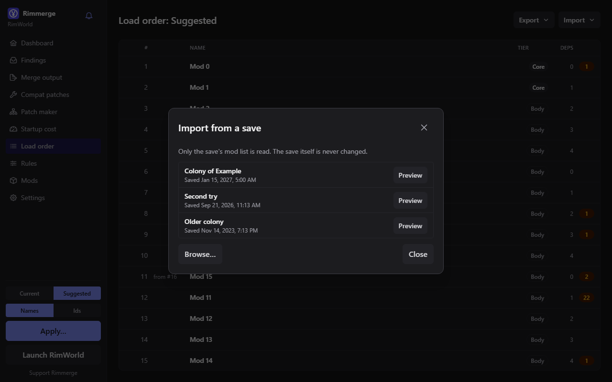

Importing rescans with the previewed order and selects **Current**: the page
then shows the imported order with a note that it isn't your active order
yet (it is not in `ModsConfig.xml`), and an Apply button. The preview closes as soon as the scan lands; pages
then refresh in the background. Nothing is written until you Apply, and the normal
Apply dialog (hard-problem confirmation, running-game check, backup) is the
only writer. An import replaces activation changes you haven't rescanned and,
if the Current order is not in the file yet, that order; the preview warns
about each.

## Mods (`/mods`, `/mods/:modId`, `/mods/:modId/details`)

Lists every discovered mod and lets you activate, deactivate and reorder
them. The **Inactive** list is on the left and the **Active** list on the
right, side by side on a window about 1,024 pixels wide or more, and stacked
(Inactive above Active) below that. Each list has its own search, source
filter, tag filter, sort and selection. A change is
staged in the app, not written to `ModsConfig.xml`: it reaches the file's
`<activeMods>` list only when you Apply (after a Rescan, when mods were added
or removed). Until then a pending-changes banner shows it, and a stale-order
warning appears once the active set no longer matches the order you last
built. `Activate` can pull in a mod's own declared dependencies first.

**The lists show the working set.** Active is the active-mod list as you
have edited it, in its own order, with every mod in it (there is no page
limit; a list is bounded at 5,000 rows, with the full count shown and a
note when it is cut). Inactive is every mod found on disk that is not in
it, by name by default (see Sorting the lists below). A mod you just activated is in Active at once, marked "not
scanned yet" until you Rescan (its tags and dependents are scan results);
a mod you just deactivated is in Inactive at once. An active mod that is
not installed is in Active with a "missing" mark.

**Searching the lists.** A list's search keeps the mods whose name or package
id contains the text, ignoring capitals, and marks every match in the mod's shown
label: a highlighted background with an underline, so the mark does not rely on colour. It
works the same in the List and the Groups view and in both lists. The list shows
either names or package ids (the toggle in the sidebar), and a mod can match in
one and not the other: a mod found by its id shows no mark while the list shows
names, and switching to package ids marks the match without searching again.
The marks come from the same matching that filters the list, so they never
disagree with it. The marked text is ordinary text, not a "mark" element, so a
screen reader reads the label as one piece and announces nothing extra per row.

**Sorting the lists.** Above each list, one button per criterion sorts what
the list shows: Load order (Active only), Name, Package ID and Last updated.
Clicking a button sorts by it in its first direction (A to Z, oldest first,
or first to last); clicking the active one again flips the direction. The
active button has a stronger border and an arrow for the direction, and its tooltip and accessible name say both the
current direction and what the next click does (for example "Sorted by name,
A to Z. Click for Z to A."). Active starts at Load order,
which is the working order itself; Inactive starts at Name, A to Z. Names and
package ids compare lowercased first, then as written, then by package id, so
the order never depends on your system language; any tie falls back to the
package id, A first, in both directions. A sort works together with the
search, tag and source filters, and it only changes what you see: it never
changes the load order, a pending edit or `ModsConfig.xml`, and it is not
saved (it is kept while the page stays open and starts over when another
project is loaded). While the sort is Last updated, each row also shows its
date (shortened when a narrow list runs out of room; hover it for the full
date). Each Active row always shows its load-order position (`#12`), whatever
the list is sorted by, so a sort cannot be mistaken for the order; the Inactive
list has no positions.

**What "Last updated" means.** It depends on where the mod comes from. A
Steam Workshop mod uses when the installed version was published on the
Workshop, as Steam records it (`timeupdated` in Steam's local
`appworkshop_294100.acf`, read from disk, no network); it is not the time the
update was downloaded to your machine. A local mod uses when
its `About/About.xml` was last modified on disk, which is not necessarily when
its author released it. RimWorld Core and the DLCs ship with the game and
have no update time of their own. A mod whose time cannot be read (no Steam
record, a missing, unreadable or implausible file or time) shows "Update time unknown". Mods
without a time always sort after the ones with one, in either direction.

**Select all and Clear selection.** Each list has a "Select all N shown"
checkbox that selects the rows matching the current search and filters,
and nothing else, and a **Clear selection** button. A row selected before
a filter hid it stays selected; the list says "(N not shown)", and Clear
removes those too. A selection is never saved and changes nothing by
itself: Activate selected and Deactivate selected still open their plan
and confirmation first, and if the plan cannot be made the dialog opens
with the reason and no way to confirm.
After an activation or a deactivation, the mods that moved (and any that
were already where you sent them) leave the selection, including a
dependency the filter was hiding; Core, which is never deactivated, stays
selected.

**Moving mods.** Three ways move a mod, and all of them end in the same
thing: the mod is placed next to a neighbour mod, named by its package id,
never by a row number, so a search or filter on the Active list never changes
which place is meant.

- *Drag and drop.* Pick up a row (or any selected row: the whole selection
  moves together, in list order, including selected mods a filter hides) and drop it between two rows of the Active
  list; a line shows the gap. Dropping a mod from the Inactive list there
  activates it at that place; dropping an Active row on the Inactive list
  deactivates it. A drop activates or deactivates straight away when the plan
  is exactly the mods you dragged and has no warning; if it would also pull in
  a dependency, or a mod still depends on one you dropped, the same
  confirmation dialog as the buttons opens first (and an activation keeps the
  place you chose). Core cannot be dropped on the Inactive list: the pointer
  shows "not allowed" and the list says why. Dragging near the top or bottom
  edge of a list scrolls it.
- *The row menu.* Each Active row has a **Move** menu (the ⋮ button): Move up,
  Move down, Move to top, Move to bottom, and **Move after…**, which opens a
  search over the Active mods and puts the row right after the one you pick.
  Each Inactive row has an **Activate at…** button with the same search, plus
  "At the start of the list" and "At the end of the list". While groups are
  usable (see Groups and colours below) both lists' ⋮ buttons open a menu that
  also holds **Groups…** and **Colour…**; the Inactive button then opens a menu
  with **Activate at…** as its first entry instead of acting at once. Up and
  Down move one shown row, so they follow a filtered view.
- *The keyboard.* **Alt+Up** and **Alt+Down** on a focused Active row move it
  one row (with the same selection rule); plain arrow keys still move the
  focus. **Shift+F10** or the **Menu** key on a focused row opens its row menu
  (the ⋮ button is left out of the Tab order, so each row is one tab stop).
  Shortcuts stay quiet inside dialogs and text fields.

Every move is announced in a polite live region that screen readers read:
"Moved *name* to position 14 of 312" (under a filter, without the total,
since the list then shows only part of the order). A move carries the
selected mods a filter hides, and the announcement says how many: "Moved 3
mods (2 not shown), starting at position 14". A move that cannot happen
says so instead ("Already at the top of this list").

**When a list cannot be reordered.** Moving within Active is offered only
while the Active list is sorted by load order, first to last (a search or
filter is fine). Under any other sort the list's position numbers do not mean
load order, so drag, the Move menu and Alt+Up/Down are all disabled and a
note above the list says why; a mod dragged in from the Inactive list is still
activated, at its default place. Inactive has no order of its own, so nothing
is ever moved there.

**What a move edits.** Moving mods, or activating a mod at a chosen place,
edits your own (Current) order. A reorder over the same set of active mods
takes effect at once and shows a note, "This isn't your active order
yet.", with an Apply button; it is not a pending scan, and Rescan is not
needed. Nothing is written until you Apply. Closing the window or switching
projects with such an order asks first. The first move (or the first
activation at a chosen place) while the suggested order is selected switches
the selection to your own order, and the page says so: "Now using your own
order. The suggested order is unchanged.", with a **View suggested** button.
While the suggested order is selected and nothing has been moved, the Active
list says that Apply will write the suggested order. Activating with the
button, with no place chosen, never switches. A move whose neighbour has left
the list in the meantime is refused with a message, changes nothing and
refreshes the lists.

**Undoing.** In the pending-changes banner, **Discard pending changes** drops
the activations and deactivations that no rescan has picked up (no scan is
needed; a reorder that already took effect stays). In the "This isn't your
active order yet." note, **Revert to your saved active order** puts your order
back to the sequence saved in `ModsConfig.xml`; it is offered only when the file lists the same
mods as your order, nothing waits for a rescan, and the file was not changed
outside Rimmerge (the outside-change note's own action covers that case). See
[load-order.md](concepts/load-order.md).

**Added and Removed marks.** A row that differs from the active mod list saved
on your computer carries a small mark. An Active row the saved list does not
have is **Added** (Apply will add it), and an Inactive row the saved list still
has is **Removed** (Apply will remove it). The mark has an icon and a word, and
its tooltip says what Apply does, so it is never colour alone; it sits after
the mod name. A mod counts as the same mod with or without its `_steam`
suffix, and a reorder alone never makes a mark. "Removed" means a mod that is
installed and still in the saved list: it stays easy to find in Inactive until
you Apply or activate it again. A mod that is in the saved list but not
installed has no row in either list, so it has no mark. Undoing a change, or
Apply, clears its mark.

**The saved list stays current.** The marks are measured against the file as it
is now, not as it was when you opened the project. While the window is visible
the app re-reads the file every 5 seconds, and once when you switch back to the
window (the usual case: you changed the list in the game or another mod
manager and came back). The read only looks: it never writes the file, and it
never touches your pending changes or your order. When nothing changed it does
nothing visible. If the list was changed outside Rimmerge, a note above the
lists says so: "Your active mod list was changed outside Rimmerge (+2, -1).
Applying would overwrite those outside changes." (When you have pending
changes of your own, it adds "Your pending changes are kept.") An outside edit
is explained by this note alone. It is never counted as your own unsaved work:
the warning when you close the window or switch project, the pending-changes
banner, the "This isn't your active order yet." note and the import
preview's "replaces your Current order" warning only look at what you changed
since Rimmerge last loaded or wrote the list. Its **Use the list from the file** button opens the same import
preview as the Load order page's Import menu, with the file's list; nothing is
replaced until you confirm there. A change that only reorders the file's mods
raises its own note without a count: "Your active order was changed outside
Rimmerge. Applying would overwrite that order." (with the same "Your pending
changes are kept." sentence when you have some). If the file is missing, cannot be read, or is only
partly written, a note says which, and the marks keep using the last list that
could be read; the next good read clears the note. Rescan and an import read the file fresh as well, and after an Apply the
saved list is what Rimmerge wrote. On every other page, a short note under the
pending-changes banner says the list was changed outside Rimmerge and links
here; it goes away after a rescan, an import or an Apply.

**Rescan mods** (top right of the page, always available) re-scans the
mods in the active list in their current order, exactly as the pending
changes banner's Rescan does. Use it after changing files on disk.
Everything that depends on the order, such as Mods that move, is
recalculated whenever either order changes (an Apply, an import).
Activating or deactivating mods only changes the pending list, so those
changes reach it after a rescan.

Opening a row from either list (`/mods/:modId`; inactive mods can be
opened too, not only active ones) shows a mod info panel: on a very wide
window (1,800 pixels or more) in a column beside the lists, and on narrower
ones as a drawer over the right edge, so the two lists keep the width. It
shows its preview image and icon when the mod ships one, its `About.xml`
description (rendered as plain text: BBCode and any other markup show
up literally, exactly as RimWorld itself displays an unrecognized tag),
workshop and homepage links (opened in your system browser, never
inside the app), and, for an active mod, its placement, tier, tags,
dependents, and live findings, with a link into the def inspector for
what it changes. In the column layout the panel follows your keyboard
focus as you move through a list (debounced, so arrowing quickly through rows
doesn't fire a load per row); the drawer opens only when you click or press
Enter on a row, since it would otherwise cover the list you are arrowing
through. When the drawer opens, keyboard focus moves into it; closing it
with `Esc` or the close button puts focus back on the row that opened it.
It closes when you navigate away. `Esc` or the close button also
closes it. The panel's own "all details" link opens
the same information as a full page (`/mods/:modId/details`) instead,
for when you want it as the main view rather than a side panel.

Each row has a small source icon after its checkbox: RimWorld Core,
RimWorld DLC, Local mod (a folder under the game's `Mods/`), or Steam
Workshop. The icon has a tooltip and screen-reader text with the same
name, and when the list is wide enough the name also shows beside it, so
shape is never the only cue. The source is decided by where the scan found the mod's folder, never guessed from its
name, package id or a Workshop id. An active mod that is not
installed has no folder, so its icon reads "Origin unknown (not
installed)" instead of a source. The icon is display only: it changes
neither selection, sorting, filtering nor the load order.

The CLI's `mods show <id>` prints the same information from the command
line; see [cli.md](cli.md).

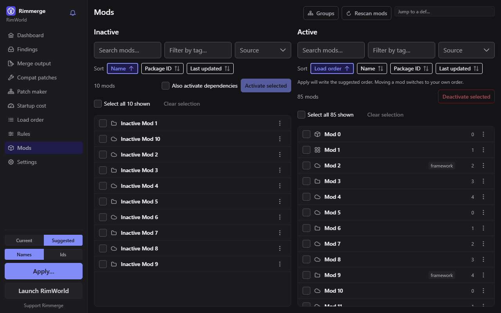

Selecting inactive mods to activate:

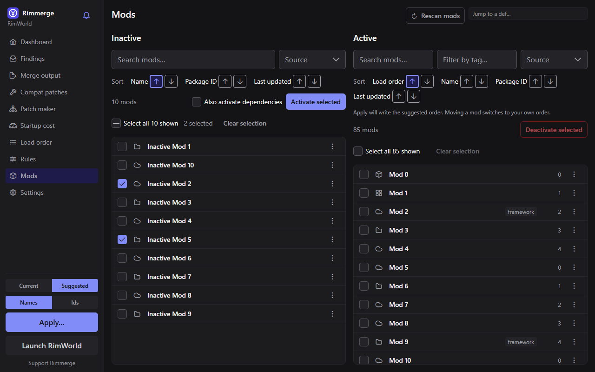

A move leaves an order to apply, and says the page now uses your own order:

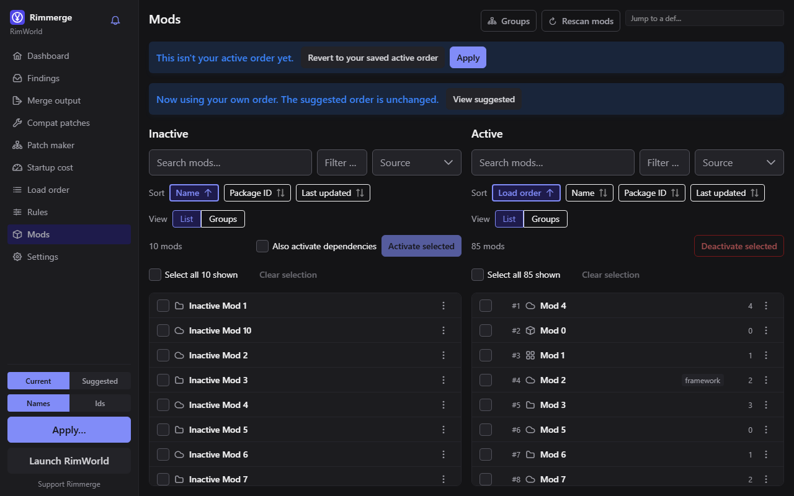

The two notes a move raises, up close: the order is not your active order yet
(with Apply and Revert to your saved active order), and the page now uses your
own order (with View suggested):

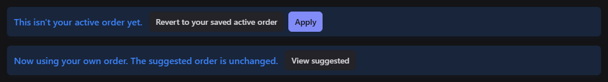

One button per criterion sorts a list; the active one shows its direction:

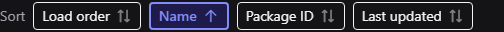

Each list remembers its own sort and its own view (List or Groups) on this
computer, so they are back after a restart and stay when you load another
project (like the choice between mod names and ids, it is one setting for the
whole app). A remembered choice the app no longer knows (a sort that was
removed, a damaged value) falls back to that list's default: the Active list
in load order, the Inactive list by name, both as a list. A remembered sort
changes nothing about the load order: the Active list restored on a name sort
still says moving is off and still shows each mod's load-order number.

**Show in load order** (the Active row's ⋮ menu, and the mod info panel for an
active mod) takes the Active list back to List view in load order, scrolls to
that mod and puts keyboard focus on its row. The Inactive list keeps its own
sort and view, and the Active list's new view and sort are remembered like any
other choice. The filter stays
when the mod is still shown under it. When the filter hides the mod, the
search, the tag, the source and the group scope are all cleared (the group
scope belongs to both lists, so the Inactive list is no longer narrowed by it;
the Inactive list's own search, tag and source stay) and a note above the list
says so. The action is not offered while the list already shows load order,
and an inactive mod has none (it is not in the load order).

Rows that differ from the saved active mod list carry an Added or Removed mark
after their name (each list is narrowed to its marked row here):

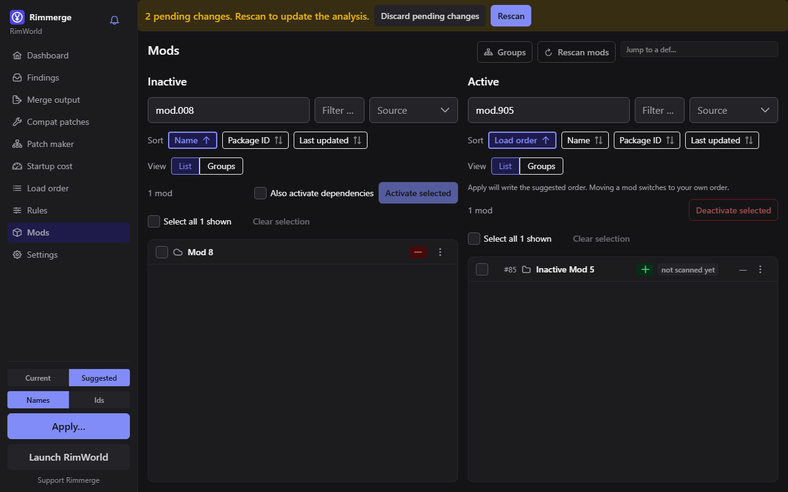

When the saved list is changed outside Rimmerge, a note says so and offers the
file's list; the marks follow the file, so the mod the file adds shows as
Removed in Inactive and the mod it lacks as Added in Active:

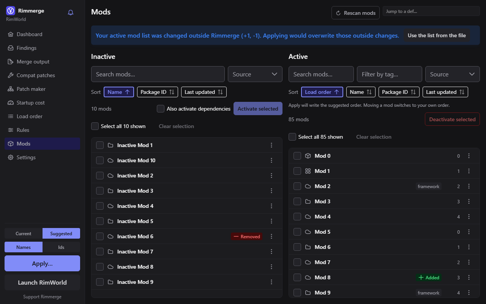

Activating pulls in dependencies on request:

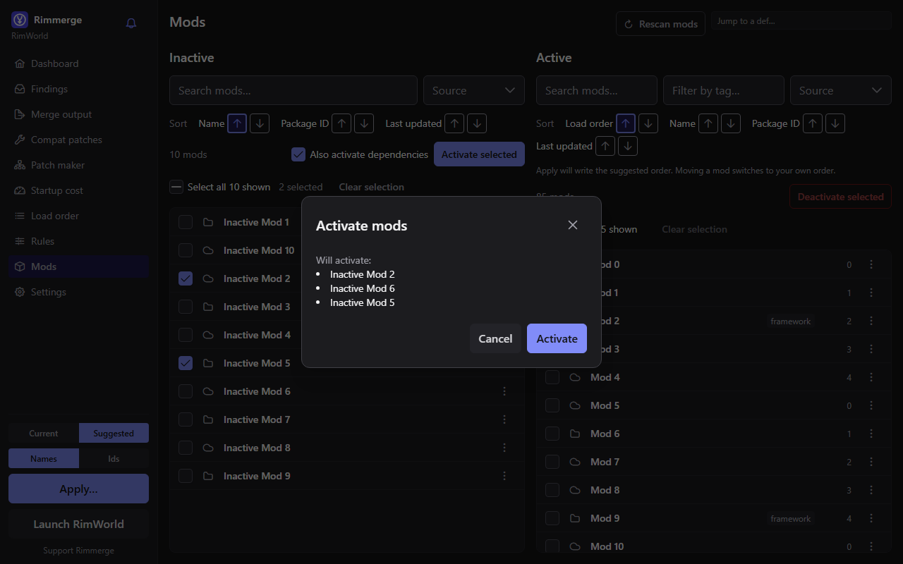

Pending changes are never silent:

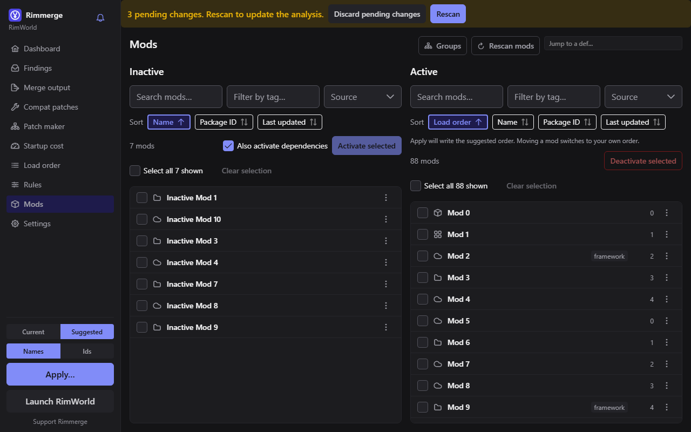

Two kinds of pending change stack into one banner:

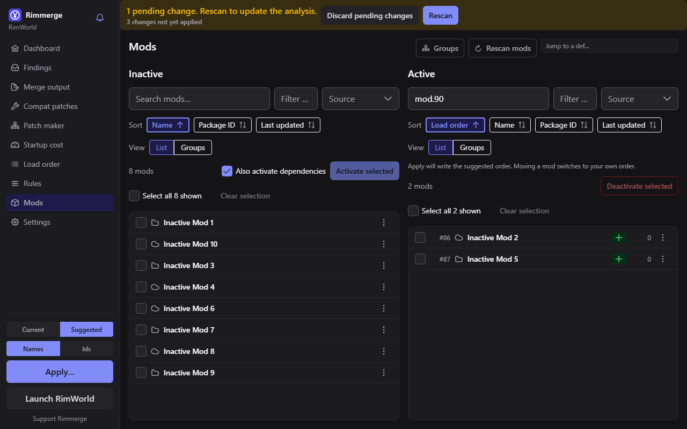

Deactivating warns about anything that still depends on the mod:

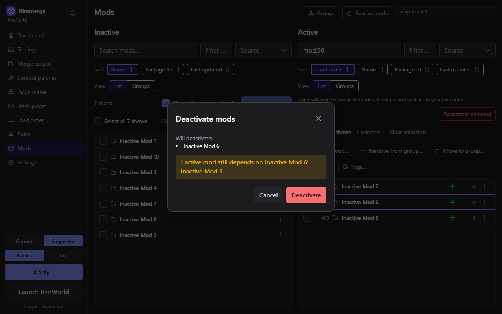

Applying a stale order (the active set changed since the order was
built) is flagged before you can proceed:

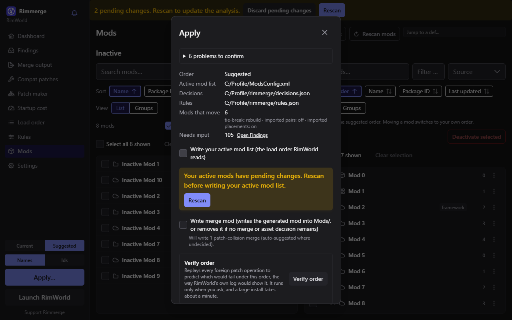

Rescanning brings everything back in sync:

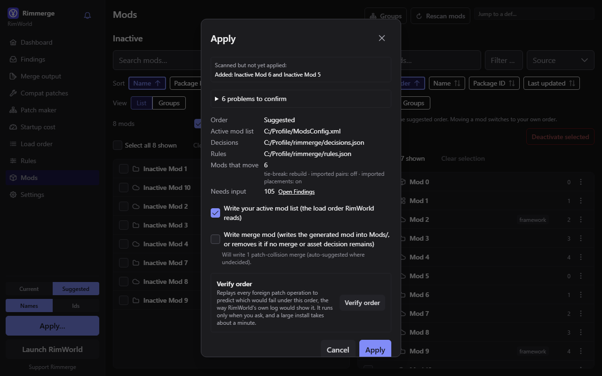
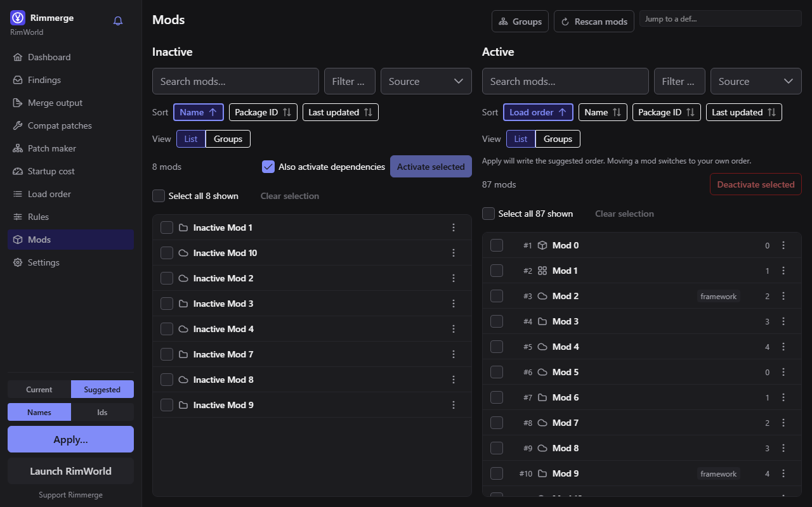

### Groups and colours

Groups are a way to find mods, nothing more. A group is virtual: it never
moves a file, never activates or deactivates a mod, and never changes your
load order. They live in the profile's `organization.json`, separate from the
sorter's rules, keyed by a mod's package id so they survive updates and
rescans.

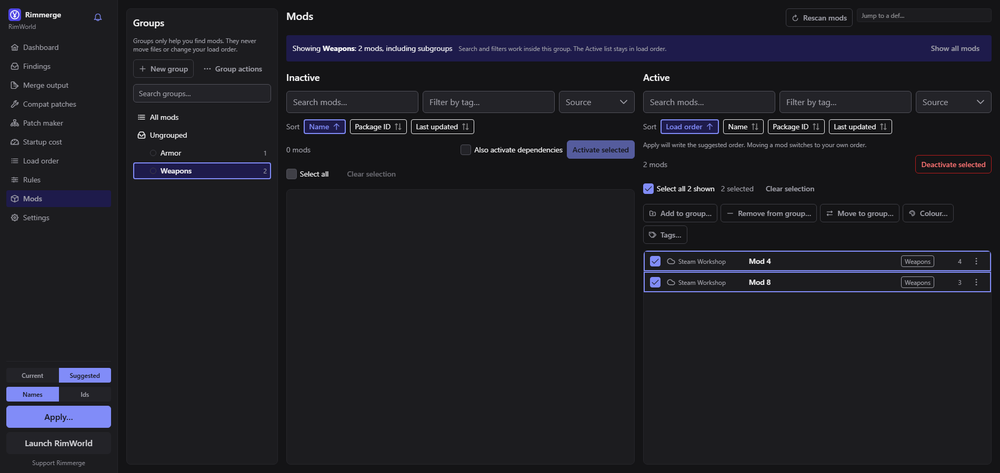

Choosing **Add to group…** in the bulk actions opens a dialog that names the
selection and lists the groups:

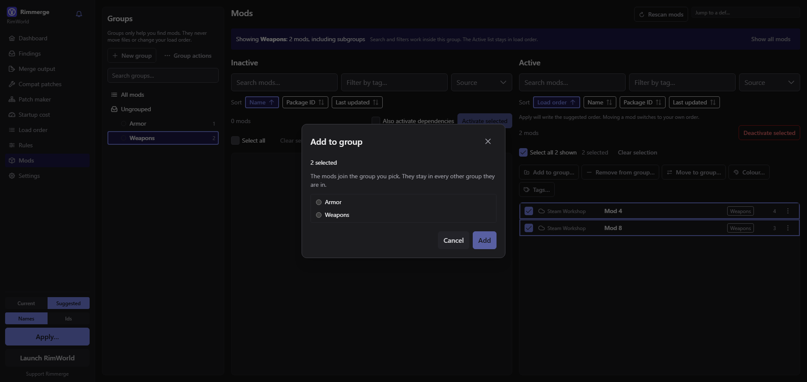

- **The Groups panel** is a column on the left of a window 1,800 pixels wide
  or more, and a drawer opened by the **Groups** button on narrower windows.
  It lists **All mods**, **Ungrouped** and your group tree. Each group shows
  how many mods it holds, counting its subgroups (each mod once). It follows
  the usual tree keys: Up and Down move, Right opens a group or enters it,
  Left closes it or goes to its parent, Home and End jump, typing a name
  jumps to it, Enter selects, F2 renames, Delete deletes, and Shift+F10 or
  the menu key opens the group menu (a right click does too).
- **Choosing a group** narrows both lists to its mods and its subgroups' mods.
  This is a filter, not a reorder: the Active list stays in load order and
  can still be reordered. Search and the other filters work inside the
  group. A bar above the lists names the group, counts its mods and says
  how many are not installed.
- **The group menu** offers a new subgroup, rename, colour, **Move group to**
  (a group cannot go inside itself or its own subgroups; those places are
  listed and disabled with the reason), **Remove mods that aren't
  installed** (the dialog lists those mods, as of the last scan, and removes
  only the ones still not installed when you confirm), and **Delete**. Deleting asks what to do with subgroups (keep
  them one level up, the default, or delete them too) and says that no mod
  is deleted or uninstalled. Names are unique among groups at the same level,
  not case sensitive; groups nest at most 8 levels.
- **On a row**, a group shows as a chip with its name (the first two, then
  "+N" with every name in its tooltip). On a narrow row the chips become
  small dots instead (up to four, then "+N"): a coloured group is a filled dot
  in its colour, a group with no colour an outlined dot, and the tooltip of each
  has the group's name. Clicking a chip or a dot narrows both lists to that
  group, the same as choosing it in the Groups panel (with the mouse only: the
  keyboard way is the panel). A mod's own colour is a stripe on the row's
  edge. A mod with no colour of its own shows the stripe in the colour of its
  first coloured group, in the order of the group tree, but fainter, so you can
  tell an inherited colour from one you set. A colour is never the only cue:
  the row names the colour and the group in text for screen readers, the info
  panel names the mod's colour and lists its groups, and a narrow row keeps the
  group names as screen-reader text. The row's ⋮ menu starts with the twelve
  colours as small swatches and one more to clear the colour (one click sets
  it and closes the menu; they are for the mouse, and the **Colour…** entry
  does the same from the keyboard). It also has **Groups…** (check a group to
  add the mod to it, clear it to remove it; each click is saved at once).
- **Creating a group from the dialog.** The Add to group dialogs (the bulk one
  and a single mod's **Groups…**) have a search box that filters the list of
  groups. When no group has the name you typed (not case sensitive), the
  dialog offers **Create group** with that name and an optional parent group
  (the top level by default). One click creates the group and puts the mods in
  it, in one save, and says how many mods it took in. If the name is already
  used at that level, or a limit is reached, nothing is created.
- **The open row.** The mod whose info panel is open is marked on its row with
  a ring and a tint, and the row says so to screen readers. Selecting rows with
  the checkboxes only draws the ring, so a selected row and the open row can be
  told apart. In the Groups panel the groups the open mod belongs to have a
  small dot before their name, and each group has a folder icon that is filled
  with the group's colour (outlined when it has none).
- **Double click.** A double click on a row (not on its checkbox, its ⋮ button
  or a chip) opens the same Activate or Deactivate dialog as the buttons, for
  that one mod, and nothing changes until you confirm. Ctrl or Shift with a
  double click is for selecting rows, so it does nothing else.
- **Tags** you added by hand now show on every row, Inactive included, and the
  tag filter works on both lists.
- **Bulk actions** appear above a list while it has a selection (each list
  keeps its own selection, and an action works on that list's selection only,
  including selected mods the filter hides; the dialog says "12 selected
  (3 not shown)"). **Add to group…** puts the mods in the group you pick and
  leaves every other membership alone. **Remove from group…** lists only the
  groups that hold at least one selected mod, with how many. **Move to group…**
  is the one way to replace a membership: you pick the group to move **from**
  (again only groups that hold a selected mod) and the group to move **to**;
  mods that are not in the first group are left alone. **Colour** sets or
  clears the colour of every selected mod. **Tags** adds or removes one tag on
  every selected mod (a tag is lowercase letters, digits, hyphens and
  underscores). Removing takes the tag off every selected mod that shows it,
  whether you added it by hand or Rimmerge inferred it; a mod that does not show
  the tag is left alone and counted as "did not change". Each action is one save, reports what changed
  ("Added 9 mods to Weapons", "3 were already in the group"), and never
  changes the selection, the load order, a pending change or `ModsConfig.xml`.
  Tags never change the sorted order.
- **Activate or deactivate a whole group**: the group menu has **Activate N
  mods…** and **Deactivate N mods…** (each mod once, subgroups included). They
  open the same Activate and Deactivate dialogs as the selection buttons, with
  a line saying how far the action reaches ("Activate 42 mods, including
  subgroups", how many are not installed and skipped, how many the current
  filter hides). Nothing is written until you Apply, like any other change.
- **Dragging onto groups.** Drag rows from either list onto a group in the
  panel to add them to it (a selected row carries the whole selection, the
  rows a filter hides included; the hint under the tree and the toast both
  say how many were not shown). A drop only ever adds: mods stay in their
  other groups, and taking mods out of one is **Remove from group…** in the
  bulk actions (or clear its box in a row's **Groups…** dialog). Drag a group onto another group to put it inside, or onto **All
  mods** to make it top level. The hovered entry gets a dashed outline, an icon
  and a sentence under the tree ("Add 3 mods to Weapons"); a place the group
  cannot go (itself, its own subgroups, where it already is, **Ungrouped**)
  shows the not-allowed cursor and says why. Other refusals, such as nesting
  past the depth limit, come from Rimmerge itself and show as an error toast.
  Only drags that start on a mod row or a group in the panel are taken; a file
  or text dragged in from elsewhere is ignored. A collapsed group opens after a
  drag has hovered it for a moment. Dragging never activates, deactivates or
  moves a mod, never changes the selection, and the Active list's own
  reordering drag works as before. Below 1,800 pixels, open the Groups drawer
  first, then drag. Without a mouse: a group's menu **Move group to…** nests it
  or makes it top level, a row's ⋮ menu **Groups…** adds that one mod to
  groups, and to add a whole selection, select the rows and use the bulk
  actions' **Add to group…**.
- **Groups view.** Each list has a **List | Groups** switch under its sort
  buttons. **Groups** shows the same mods as folders: your group tree, each
  folder with its colour icon, its name and how many mods it holds (counting its
  subfolders, each mod once). Inside a folder its subfolders come first, then its
  own mods in the list's sort order, and **Not in a group** comes last (only
  when it holds mods). A mod in two groups appears under each, with an "also in
  1" mark whose tooltip names the other groups. Selection is per mod: ticking
  either copy ticks both. Rows keep their load-order number on the Active list.
  The two lists switch separately, and each remembers its choice across restarts
  and project switches. Groups view needs a usable groups file; while it is not,
  the switch says so and shows List (the remembered choice comes back once the
  file can be used).
  - **Folding.** Click a folder, or use the keys, to fold it (its mods leave
    the screen, its count stays). **Collapse all** and **Expand all** sit beside
    the switch. Each list remembers its own folded folders per profile on this
    computer, and a folder you delete drops out of the memory.
  - **Keys.** The list is one tab stop. Up, Down, Home and End move across
    headers and mods. On a folder, Right opens a folded one or enters an open
    one, Left folds an open one or goes to the folder above, and Enter or Space
    toggles it. On a mod, Left goes to its folder, Enter opens the info panel and
    Space selects it. Shift with Up or Down, or Space, selects a range over the
    rows you can see (a folder header adds nothing, and a mod seen twice counts
    once). Ctrl+A selects every mod the filter matches, including mods inside
    folded folders. The menu key (or Shift+F10) opens a folder's menu. For
    screen readers the list is a tree grid: every row has a level, and folders
    say whether they are open.
  - **Folder menu** (the ⋮ button on a folder): **Select all in folder** (every
    mod in it and its subfolders that the list's search, tag and source filters
    match, folded or not), **Activate all…** and **Deactivate all…** (the same
    dialogs as the group menu in the Groups panel). **Not in a group** offers
    only the selection.
  - **Dragging onto a folder.** Drop rows on a folder's header to add them to
    that group. A drop only adds: it never activates, deactivates or moves a mod,
    even for an Inactive mod dropped on a folder in the Active list. Dropping on
    **Not in a group** is refused, with the reason on screen. A folded folder
    opens after a drag has hovered it for a moment.
  - **Moving is off.** The Active list cannot be reordered in Groups view (a
    note says so, the row menu's Move entries are disabled and Alt+Arrow does
    nothing); switch to List to move mods. Dragging an Inactive mod to the
    Active list outside a folder header still activates it at the end.
  - **Empty folders** show with 0 while the list has no search, tag or source
    filter, and are left out when it has one. When nothing matches, the list says
    so. A very large library is cut at 10,000 lines; a note says how many lines
    are not shown, and folding folders or searching brings the rest back.
- **Copy from another profile...** (the groups panel) copies another
  profile's groups and colours into this one. Each profile keeps its own
  `organization.json`; pick the other profile's folder (the one holding that
  file). Profile folders sit side by side, one per `ModsConfig.xml`, in the
  `profiles` folder under `%LOCALAPPDATA%\rimmerge` and named by a short code
  (the picker opens there, beside this profile's own folder). The dialog
  previews the result, then you choose a mode:
  - **Merge** matches a source group to one here by its path: the same names
    from the top level, ignoring capitals. A match takes the source's members
    and keeps its own name and id; groups with no match are created under the
    parent their own parent matched or created, so the same name at another
    depth is another group. Your colours win: a group or mod colour you have
    set stays (a differing group colour is listed as a clash, a differing mod
    colour is counted), and only a colour you have not set is filled in.
  - **Replace** removes everything here and puts the other profile's groups
    and colours in its place (new group numbers, never one this profile used
    before). It asks for a confirmation with **Cancel** focused.
  - Every copy is checked against the same limits as an edit (groups, nesting,
    mods per group and in total, coloured mods, the size of the file) as a
    whole: one over the limit is refused with the reason and nothing is
    copied, in either mode. A folder that is not a folder, is this profile's own
    folder, holds exactly what this profile already has, has no
    `organization.json`, has an empty one, or has one that cannot
    be read (too large, damaged, from a newer version, groups that do not fit
    together) is refused the same way. The other profile's folder is only read,
    and only its `organization.json`. A mod that is not installed keeps its
    place in a group, as everywhere else. The copy is one save, and never
    changes the load order, the active mods or the rules.
- If `organization.json` cannot be read, a notice says so and groups are
  read-only. If another program only has the file open, **Rescan and try
  again** reads it again (it is a full rescan of your mods, the only thing that
  reads the file); otherwise **Start over** keeps a copy of the file and begins
  with no groups. Your mods and load order are never affected.

## Rules

Every rule feeding the sorter (your own pair/placement rules, and, if
imported, rules from a RimSort database), with edit and delete actions
and, for an imported rule, a "promote to mine" action so it survives a
re-import. See [concepts/rules-databases.md](concepts/rules-databases.md).

Tags you set on the Mods page's **Tags…** action (one tag on many mods, either
list) are manual tag overrides like the ones set here, saved in the same rules
file with one save. An **Add** is a manual override; a **Remove** deletes your
manual add if there is one and records a "hide" override only when an inferred
tag would still show, so the file never gains an override that does nothing.
Tags are not a sorter input, so tagging never changes the sorted order.

## Def inspector (`/defs/:defRef`)

Everything about one def or template: which mods contribute to it,
every patch operation touching it, its template inheritance chain, and
the merged (effective) def under the current order.

## Merge editor (`/merge/:key`)

One finding's field-level diff and merge plan: pick which mod's value
wins per field, or accept the auto-merge where every candidate order
agrees. Feeds the merge mod (see [concepts/merge.md](concepts/merge.md)).

## Merge mod (`/merge-mod`)

The generated compatibility mod covering every finding you've resolved
with a merge decision, with its own coverage summary and an export action.

Deciding a merge does not put anything in your `Mods/` folder. The Apply
dialog's **Write merge mod** checkbox starts unchecked (like the CLI's
opt-in `apply --write-merge-mod`), even when complete merges exist: tick
it to render the generated mod into `Mods/` (or remove it when no merge
or asset decision remains). Your choice holds until you close the dialog,
and the dialog starts unchecked again the next time it opens. An apply
without it still saves your decisions and writes `ModsConfig.xml`, but
leaves any merge mod already in `Mods/` as it was, so it can lag behind
decisions made since. The dialog works out what the merge mod would contain
when it first opens and again after the session changes (a swap, a decision,
a rescan), which takes a few seconds on a large install; reopening it with
nothing changed reuses the last answer, so a merge-mod folder added or removed
on disk outside the app is picked up at the next such change. Until the
answer arrives, the section reads "Loading…" and the checkbox is disabled, so it never shows a
previous session's answer. If that lookup fails, the section shows
no summary, never a previous session's.

## Compatibility patches (`/patches`, `/patches/:patchId`, `/patches/:patchId/merge/:key`)

A patch project is a user-chosen scope of two or more mods with its own
decisions, exported as a small, independently publishable mod. It uses
the same underlying engine as the merge mod, scoped down. A patch's own
findings open the same merge editor the profile-wide one uses
(`/patches/:patchId/merge/:key`), but validated against that patch's
own narrower scope instead of the whole install. See
[concepts/merge.md](concepts/merge.md).

## Assignments (`/assignments`, the patch maker)

The patch maker: infers a reference-mod-to-target-mod assignment
schema (e.g. "which of these fields does a race-support mod need per
race?"), then a row-editor UI to fill in and export one `Defs/`-only
mod per project. `/assignments/new` is the creation wizard;
`/assignments/:assignmentId` is the row editor itself, one tab per
section for a project covering more than one def type.

### Seeing a def's texture

A target def shows what it looks like, so you can tell which race or item
a row is for without opening the game.

- **Queue thumbnails.** Each row of the coverage queue has a 40 px
  preview of the def's default view. Rows load their preview only when
  they are within a short distance of the visible part of the list's own
  scroll area, and let it go again some
  seconds after they scroll away. A preview is decorative: the row's text
  still names the def.
- **The viewer.** Selecting a row shows a 160 px viewer at the top of the
  row editor (not for a free-standing "new def" row, which has no def on
  disk). Its controls:
  - **Facing** (N, E, S, W), for a directional graphic. It starts on south;
    arrow keys move between the four. A west side drawn from the east
    file, mirrored (which the game does only when the graphic allows
    flipping), says so.
  - **Variant**, previous and next, for a def with several textures (a body
    type, a life stage, a collection member). Past eight variants it is a
    dropdown.
  - **Source**, a dropdown shown only when the def has more than one place
    its textures come from (the graphic, an icon, a pawn kind that uses
    the race, and so on).
  - A line names the mod whose file is shown, and flags it when that mod
    is not the def's owner (a retexture replacing the owner's art).
- **Item picker.** Each def in an item picker has a 24 px preview too; the
  project's own new rows have none, since they are not on disk yet.

What is shown is what the game would load under the selected order: the
def's effective data (after patches) decides the texture path, and the
last-loaded mod shipping that path wins. When there is nothing to show,
the viewer says why rather than leaving a blank:

- the texture is built into the game or an asset bundle, which
  Rimmerge cannot read (or it was found nowhere, and might be);
- no file exists, so the game would show its error texture;
- the game loads a `.dds` file: if a PNG or JPEG sits beside it, that
  copy is shown and labelled; otherwise there is no preview, and a `.dds`
  the game cannot decode is called out;
- the file is too large or not a supported image;
- the def shows no texture of its own, or is a humanlike race the game
  assembles from body, head and hair parts at run time.

Some graphics are found by path rather than by a rule of the game (a
field whose text names texture files): those are labelled as such and are
approximate. Nothing here changes the load order, a finding or an export.

## Startup

The per-mod startup-cost table (patch operation counts, slow-shape
xpaths, texture/DLL counts and bytes), plus, once you've imported a
`Player.log`, real per-mod timing next to the static estimate.

### Importing a game log

The **Import game log** button (here and on the dashboard) reads a
`Player.log` or an in-game console snapshot (a copy of the debug
console, saved under any name; the picker lists `.log` and `.txt` files
first and offers all files). The kind comes from the file's content,
never its name, and the result is never cached or written anywhere. The
summary under the button says what the file is and what it covers, in
the same terms as the CLI's `log import` ([cli.md](cli.md)):

- **Kind**: `Player.log` or console snapshot.
- **Coverage**, one line. A `Player.log` gives its startup passes and
  how it ends: a clean exit, a crash (with the crash report location the
  log prints), or cut off with no exit footer (a freeze, a force-close,
  or a copy taken while the game ran). A snapshot says it holds only the
  entries the console held; when it is at the console's cap the game
  dropped the older entries, and when it is over the cap it is several
  copies pasted together (or a parsing problem). A copy that starts
  mid-entry says so.
- **Logging gaps**: a warning when the game stopped writing messages
  (after 10,000 messages it stops until it resumes): how many gaps, how
  many never resumed (everything after one is unreliable), the gaps as
  line ranges, and the share of the log's entries in families that span
  a gap, whose counts may be short.
- **Read losses**: a warning when the reader had to bound something,
  one line per non-zero counter of the CLI's `read_stats` (over-long
  lines, invalid UTF-8, unlisted gaps, cut crash-report paths, and so
  on), with each count.

The gap list shows the first 5 gaps and "and N more" (the total includes
gaps the reader counted but did not list; the CLI lists 10). The share
of entries in families that span a gap is never shown as 0% or 100%
while part of the log lies outside it.

A snapshot is never presented as a whole session. Some counts become
lower bounds, shown as "at least N" with a note saying why:

- **A console snapshot.** The observed-timer column and the apply
  dialog's def-cache build time are startup facts only a `Player.log`
  holds, so a snapshot shows a dash in each timer cell (the reason, "not
  available from a console snapshot", is the cell's accessible text and
  tooltip, and the snapshot note above the table says it once) and no
  build time; its bad-dimension DDS counts read "at least N".
- **A `Player.log` with a logging gap.** It keeps its timers, but the
  game may not have written all of them: the timers and the
  bad-dimension DDS counts read "at least N", and a note says the counts
  may be short because the game stopped writing.
- **A cut-off `Player.log`**: one that ended without a clean exit before
  any patch result was logged, so the game may not have reached the
  loading that holds those facts. It is treated like a gappy log, with
  its own note; a log that is both cut off and gappy shows both notes,
  cut-off first. A non-clean end that did log a patch result keeps exact
  counts: a copy taken while the game runs is the common case, and "at
  least" on every such copy would stop meaning anything.

The apply dialog's predicted-versus-observed panel still lists what a
snapshot, a gappy log or a cut-off log holds, with a note for each limit
that applies: "not observed" is then no evidence a failure did not
happen. A snapshot's mod-list block still counts as evidence of the order
the game ran under, so the different-order warning works for one. The
per-class families and their attribution, which the CLI lists, are not
shown in the app.

## Settings

Every field in [settings.md](settings.md), editable, with an inline
note on whether it can change what the sorter produces. If
`app-settings.json` itself couldn't be read (damaged or unreadable;
see [privacy-and-network.md](privacy-and-network.md)), the Internet access
section shows a persistent warning saying so, since every network
switch is silently off until settings are saved again and that's
otherwise invisible.

At the bottom, an About section shows the installed version and links
to the project's GitHub repository, its issues page, and a support
page. Each opens in your system browser through the same fixed-target
opener every other external link in the app uses (see
[privacy-and-network.md](privacy-and-network.md)'s "Links you click"
section). The sidebar also carries a small, unobtrusive "Support
Rimmerge" text link to the same support page.

## Notifications

A bell in the sidebar's brand row shows every active notice: a
count badge, and a popover listing each one with its own action
buttons, a Dismiss, and, for the kinds that allow it, "Don't remind me
again" (mute). A notice reappears once its own underlying fact changes
again, even after being dismissed; muting silences a whole kind until
explicitly unmuted from Settings → Internet access.

- **Welcome**, the first-run notice, is also a prominent Dashboard
  section (not only a bell entry) the first time a project loads: it
  explains, in plain terms, what Rimmerge can contact over the network,
  when, and what it sends (see
  [privacy-and-network.md](privacy-and-network.md)). It has four
  switches, all on by default: *Check for updates*, *Refresh rule
  databases automatically*, *Steam Workshop database* (about 49 MB,
  downloaded only when you click Refresh), and the master *Allow
  internet access*. Answering fetches nothing. **Keep these settings** and **Turn off internet access** are
  equal-weight buttons, so turning internet features off is never a
  buried option; dismissing the card without clicking either also
  counts as "keep these settings," since the explanation was visible
  first. A separate **Use recommended settings** button appears only
  when this profile's sorter/ledger settings differ from their built-in
  defaults. Any answer, including closing the card, also saves the
  app-wide settings file when there is none yet, so the choices shown
  stay yours if a later version changes a default.
- **A new Rimmerge version** is announced once GitHub reports one newer
  than what's running, with a link to its release page and a
  Settings-page shortcut. Dismissing skips that version; a later
  release shows again. Nothing automatic (this check, and the
  rule-database refresh below) ever runs before Welcome is answered.
  The once-per-launch flag is still consumed on a launch spent showing
  Welcome, so the first automatic check runs on the *next* launch after
  answering it, not the moment it's answered.
- **Rule databases stale** warns when an enabled source hasn't
  refreshed recently enough, with a Refresh-now action. The wording
  depends on whether automatic refresh is expected to cover the source.
  The action refreshes exactly the sources the notice lists, not every
  enabled one.
- **Recommended rule databases** is shown, after Welcome is answered
  and while internet access is on, when a recommended source is off or is
  on but has never been downloaded and nothing automatic will fetch it
  (the Steam Workshop database always falls here). Its **Turn on and
  download** button turns the recommended sources on and refreshes them
  now; see [concepts/rules-databases.md](concepts/rules-databases.md).
- **New rule content to import** is a passive signal (open the
  Rules page's Import from RimSort button) once a source's cache has
  content this profile hasn't imported yet. Nothing imports on its
  own.

  While the Dashboard's **Get the recommended rules** step is offering a
  source (step one, above), these two notices leave that source to the
  step, so there is one call to action instead of two. Once the step is
  done or skipped, or while it is not available, both behave as described.
  Skipping the step is what brings the quiet reminder back.
- **Game version changed** (after a RimWorld update) points at the
  Compatibility patches page, since exported patches and patch-maker
  mods still declare the old game version until re-exported; dismissing
  it acknowledges the new version for this profile.

## Language

The UI itself (every page above, its labels and prose) is available in
English and twelve translated languages: Simplified Chinese (`zh-CN`),
Brazilian Portuguese (`pt-BR`), Russian (`ru`), Ukrainian (`uk`), Polish
(`pl`), German (`de`), French (`fr`), Spanish (`es-ES`), Turkish (`tr`),
Japanese (`ja`), Korean (`ko`) and Traditional Chinese (`zh-TW`). The
language is a display preference, picked from the Settings page or from
the Setup page before a project is loaded. It is stored on this machine
and applied immediately with no restart. It defaults to your OS language
when that matches one of these, English otherwise. A missing translation
falls back to English rather than showing a raw key. This never affects
the CLI, which stays English-only, and never affects a stored pair
rule's own `comment`. A rule created from a verify suggestion keeps its
English wording even under a non-English UI, since a comment can be
shared or published to a rules database where English is the common
language.

Every locale is fully translated: every UI string has a value, with no
fallback to English left. All but `pt-BR` still carry the picker's own
"(preview)" suffix and an in-app note on where to report a wrong
translation. That label means machine-drafted and not yet reviewed end
to end by a native speaker. It is about review, not coverage, and stays
until that review happens.
See [translating.md](translating.md) if you'd like to help review, or
to translate a newly added English key before the next pass.

## Safety, everywhere

Writing `ModsConfig.xml` happens in two places only, and each asks
first: the Apply dialog (opened from the sidebar's Apply button or the
Dashboard strip; it also names any hard problem in the order first), and
a patch or assignment export with "install" ticked (which also adds the
generated mod to the list). The Mods page's activate/deactivate actions
and reorders only stage a change in the app; it reaches the file when you
Apply. An install export writes your current order, so an order you have not
applied yet (a move, an import) goes into the file with it; the export panel
warns when that is the case, and warns too when the active mod list was
changed outside Rimmerge, since the install writes your order over those
changes. Every
write takes a timestamped backup first, and each refuses to write while
RimWorld looks like it is running unless you confirm the override.

Keeping the Mods page's Added and Removed marks current reads `ModsConfig.xml`
every few seconds but never writes it, and reads nothing else. It uses no
network.

Launching RimWorld writes nothing; the Apply its prompt may offer is the
ordinary Apply above. Exporting a load order writes one `.rml` file where you
chose in the save dialog and never touches `ModsConfig.xml`; importing one
only previews, then rescans, until you Apply.
